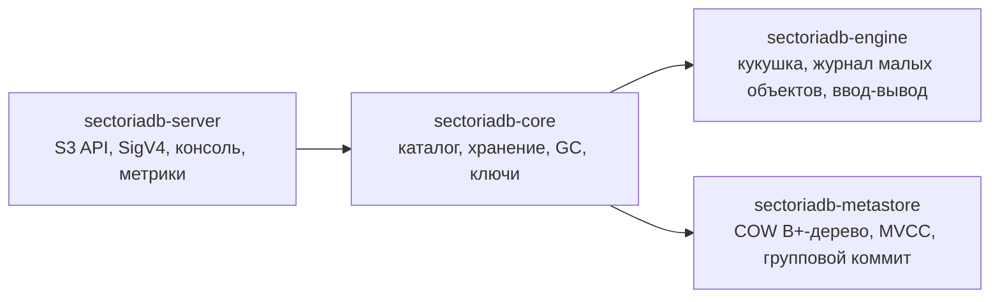
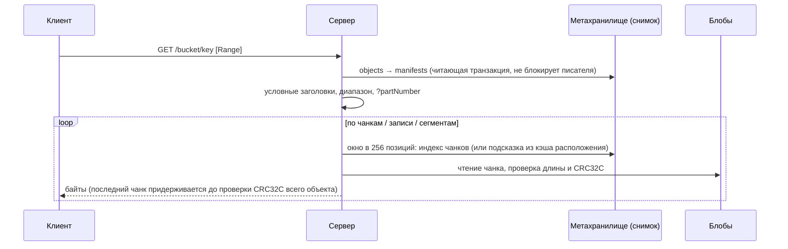

# Обзор архитектуры

SectoriaDB — S3-совместимое хранилище объектов на Java 21 и Spring Boot. Данные лежат в собственных файлах-блобах, метаданные — во встроенном
транзакционном хранилище (copy-on-write B+-дерево в одном файле `sectoria.db`); внешней базы данных нет. Этот документ — карта; детали в соседних документах.

## Модули



| Модуль | Зависимости | Что внутри |
|---|---|---|
| `sectoriadb-metastore` | JDK, slf4j | страницы, деревья, снимки, групповой коммит, восстановление записи — [metastore.md](metastore.md) |
| `sectoriadb-engine` | JDK, slf4j | кукушкина таблица (`engine.blob`), журнал малых объектов, форматы файлов (`engine.format`), позиционный ввод-вывод (`engine.io`), XXH64/CRC32C, размещение HRW (`engine.placement`) — [storage-engine.md](storage-engine.md) |
| `sectoriadb-core` | engine, metastore, Spring (только `config`), Jackson | `catalog` (сущности и интерфейсы репозиториев), `catalog.metastore` (реализации поверх метахранилища — единственный импортёр модуля `metastore`), `storage` (запись/чтение объектов, чанки, пулы, кэши), `storage.multipart`, `maintenance` (+`gc`: сборщик, расширение, чистка файлов), `security`, `audit`, `checksum`, `metrics`, `config` |
| `sectoriadb-server` | core | `s3.*` (контроллеры, SigV4, ACL/политики, XML), `observability`, `shell`, `scheduler` |

Модуль `metastore` и `engine` сообщают о событиях через собственные интерфейсы (`MetaStoreListener`, `EngineListener`); ядро подключает к ним метрики переходниками,
сервер реализует `StorageMetrics` на Micrometer. Правила зависимостей проверяют `ModuleDependencyGuardTest` в каждом модуле ([development.md](../guide/development.md)).

## Как устроено хранение

| Понятие S3 | Внутри |
|---|---|
| Бакет | пул (`pool`): запись в метахранилище и каталог `<data-dir>/<бакет>` |
| Объект | манифест (`manifest`) в метахранилище: размер, ETag, суммы, ACL, метаданные и способ хранения; индекс `(бакет, ключ) → манифест` |
| Данные | блобы: `blob_*.raw` (кукушкины хэш-таблицы чанков) и `small_*.sob` (журналы малых объектов) |

Вид хранения (`storageKind`) выбирается по размеру:

| Размер | Вид | Где лежит |
|---|---|---|
| 0 | `EMPTY` | только манифест |
| 1 … `default-chunk-size`−1 (16 КиБ) | `SMALL` | одна запись в `small_*.sob` пула |
| ≥ `default-chunk-size` | `CHUNKED` | чанки в кукушкиных таблицах пула; манифест хранит упорядоченный список 64-битных ключей чанков |
| собранный `CompleteMultipartUpload` | `MULTIPART` | сегменты по частям (чанки и малые записи), границы частей в манифесте |

Чанк адресуется содержимым (ключ — XXH64). Если такой чанк уже есть в пуле, байты сравниваются и повторно не пишутся (дедупликация по всему бакету, счётчик ссылок `refcount`).
Новый чанк кладётся в один из блобов пула по взвешенному rendezvous-хэшированию (вес — свободное место); где чанк лежит на самом деле, говорит индекс чанков в метахранилище.

## Путь запроса

Фильтры S3-порта по порядку: `RequestObservabilityFilter` (идентификатор запроса, MDC, метрики) → `RequestBodyGuardFilter` (минимальная скорость тела) →
`SigV4Filter` (подпись, лимиты на ключ, анонимный доступ) → контроллер. Порт метрик обслуживается отдельным Tomcat без этих фильтров.

### PUT объекта

```mermaid
sequenceDiagram
    participant C as Клиент
    participant S as Сервер (фильтры, контроллер)
    participant W as ObjectWriter / ChunkStore
    participant B as Блобы (кукушка, .sob)
    participant M as Метахранилище
    C->>S: PUT /bucket/key (подпись SigV4, тело)
    S->>S: проверки: подпись, размер объявлен ≤ 5 ГиБ, место для спула, условия, ACL
    S->>W: stageStream(тело)
    W->>W: тело во временный файл, один проход: MD5 + CRC32C + сумма клиента
    W->>W: сверка Content-MD5 / x-amz-checksum-* (несовпадение: BadDigest, ничего не записано)
    W->>B: hold затвора загрузок; EMPTY: ничего; SMALL: append в .sob; CHUNKED: окна по 256 чанков, дедупликация или вставка по HRW
    W->>B: барьер долговечности (fsync записанных чанков)
    S->>W: commitObject
    W->>M: ОДНА транзакция (групповой коммит): ссылки на чанки, манифест, objects[(bucket,key)], старая версия в очередь GC, счётчики
    M-->>W: fsync страниц, мета-страница, fsync
    W->>W: снять hold
    S-->>C: 200 ETag
```

Данные записываются **до** коммита метаданных и вне транзакции; сбой между ними оставляет безвредный мусор для сборщика, но не объект без данных.
Условный `PUT` (`If-None-Match: *`, `If-Match`) проверяется внутри транзакции.

### GET объекта



При несовпадении CRC: если заголовки ещё не ушли — `500`, иначе соединение обрывается. `Range` опирается только на CRC чанков/записей.

### DELETE объекта

Одна транзакция: `objects.delete`, манифест удаляется, ссылки на его чанки освобождаются (`refcount -= …`; чанки с нулём ставятся в очередь `chunk_gc`),
в `deleted_manifests` ставится надгробие — адреса записей малых объектов версии. Место освобождает позже сборщик мусора ([garbage-collection.md](garbage-collection.md)). Перезапись объекта делает то же с прежней версией в транзакции коммита новой.

### Multipart

```mermaid
sequenceDiagram
    participant C as Клиент
    participant S as Сервер
    participant M as Метахранилище
    participant B as Блобы
    C->>S: CreateMultipartUpload
    S->>M: транзакция: mpu_uploads, mpu_by_bucket
    loop каждая часть
        C->>S: UploadPart(n)
        S->>B: обычный путь записи (спул, суммы, чанки или малая запись, барьер)
        S->>M: транзакция: скрытый манифест части + строка mpu_parts + ссылки; прежняя часть n освобождается
    end
    C->>S: CompleteMultipartUpload(список частей)
    S->>M: ОДНА транзакция: проверка ETag/сумм/порядка/min-part-size, манифест MULTIPART, передача ссылок от частей к объекту, objects → новый манифест
    S-->>C: 200 (данные не читались и не писались)
```

Подробности и состояния загрузки — [metadata-model.md](metadata-model.md).

## Инварианты

1. **Данные до метаданных.** Объект виден только после коммита метаданных; к этому моменту все его чанки долговечны (барьер перед коммитом).
2. **Метаданные атомарны.** Операция S3, меняющая метаданные, — ровно одна транзакция; сбой оставляет прежнее или новое состояние целиком.
3. **Ссылки считаются.** `refcount` чанка равен числу позиций с его ключом во всех живых `CHUNKED`/`MULTIPART`-манифестах (включая скрытые части); `refcount = 0` ⇔ чанк в очереди `chunk_gc`.
4. **Слот чанка освобождается только сборщиком**, через период ожидания G и после повторной проверки в эксклюзивной транзакции; копии без записи индекса — только под затвором загрузок.
5. **Каждое чтение проверяется** CRC32C чанка/записи; полное чтение — ещё и CRC32C объекта ([integrity.md](integrity.md)).
6. **Один писатель метахранилища**, читатели на снимках: нет грязных чтений, потерянных обновлений; последний зафиксированный `PUT` ключа побеждает.
7. **Один процесс на `meta-dir`.**
8. **Один размер чанка на пул.**

## Конкурентность и сбои в двух словах

- Запись метаданных идёт через групповой коммит: тела записи из разных запросов делят один коммит (два `fsync`), отказ одного тела откатывает только его.
- Вставка в кукушку не держит блокировку таблицы на `fsync`: общий барьер долговечности перед коммитом.
- Сбой записи метахранилища (полный диск) отравляет только запись; чтение продолжается, запись восстанавливается сама.
- `resize` блоба идёт под записью: блоб замораживается, чанки переносятся порциями, коммит одной транзакцией переключает индекс.

## Глоссарий

| Термин | Значение |
|---|---|
| пул (pool) | бакет: набор блобов и индекс чанков, общие ключи и дедупликация |
| блоб (blob) | файл данных пула: кукушкин `blob_*.raw` или журнал малых объектов `small_*.sob` |
| чанк (chunk) | кусок объекта фиксированного размера (16 КиБ), адресуется 64-битным ключом XXH64 |
| слот (slot) | место чанка в кукушкиной таблице (метаданные 32 байта + область данных) |
| манифест (manifest) | запись версии объекта: список ключей чанков / положение малой записи / сегменты частей, ETag, суммы, ACL |
| надгробие (tombstone) | строка `deleted_manifests` выведенной из обращения версии: адреса её записей малых объектов, ждущие сборщика |
| refcount | число ссылок на чанк из живых манифестов |
| HRW | взвешенное rendezvous-хэширование: выбор блоба для нового чанка |
| барьер долговечности | групповой `fsync` кукушки перед коммитом метаданных |
| затвор загрузок (UploadGate), hold | удержание, которое загрузка держит от записи данных до коммита; сборщик не освобождает копии без записи индекса, пока оно есть |
| период ожидания G | `sectoriadb.gc.grace`: возраст мусора, раньше которого его не собирают |
| сирота (orphan) | физическая копия чанка в блобе, на которую индекс не указывает (параллельная загрузка) |
| копия-бродяга (stray) | занятый слот без записи индекса (оборванная загрузка) |
| карантин (quarantine) | слот с неверной записью метаданных: не читается, не перезаписывается |
| мета-страница | страница 0/1 файла `sectoria.db`, переключение которой делает коммит видимым |
